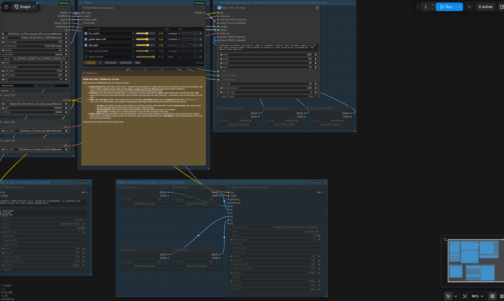

# Dials (alpha)

Training-free steering for MiniMax H3 (also MOSS-Image and Krea 2), made from prompt pairs. Write two prompts that differ in one quality
(*"stands perfectly still"* vs *"runs across the scene"*); Make Dial turns the difference into a ~14 KB file that
works like a strength slider. Negative strength moves every generation toward the first prompt, positive toward the
second. Ported from [ComfyUI-Dials](https://github.com/matlowai/ComfyUI-Dials); this is where new Dials work happens.

## Nodes (category MAINodes/Dials)

| node | what it does |
|---|---|
| **Dial Rack** | Any number of dials on one model. One row per dial: on/off, dial, strength (slider and number), solo, **H** to hold a direction. **+ Add dial** adds a row; dials wired into the `dial_N` inputs (straight from Make Dial) appear as rows too. After a run the node shows each dial's size, the combined shift, and dials that overlap (reinforce or cancel). A **Map** moves two rows together on a 2D square (the dot is your prompt), with saved pairings to switch between. |
| **Make Dial** | Prompt pairs (`A ||| B` per line, `{subject}` expanded over a subjects list) to a dial. Saves to `models/loras/dials/<name>.safetensors` and outputs the dial for a rack input. Shows pair agreement (above 0.6 is a clean direction) and how much generic wording shift was removed. Also takes weighted pairs (`A ||| B :: 2`) and prompt sets (`+1 …` / `-1 …` lines). |
| **Dial Hold Map** | De-rope with one rack: takes the Dial Rack's model and H3 Time Smear's `hold_map_used` and gives stage 2 the same rack with its time curves in real clip time. Rows without a time curve pass through unchanged. |
| **Combine Dials** | `weight_a * a + weight_b * b` as one new dial, optionally removing b's direction from a first (orthogonalize). Plain mixing is easier in the rack. |
| **Make Dial from Pictures** | Two picture groups (batches, any number of single pictures of any size, and/or a folder inside `input/` on `folder_a` / `folder_b`) and a shared framing to a post-refiner dial. Negative strength moves toward A, positive toward B. Equal counts pair by index for agreement; unequal counts use group means and report agreement as n/a. Saves and connects to the rack like Make Dial. |
| **Render Preset** | The Simple front door's render recipe in one node, switched together by named presets: model, LoRA and strength, flow shifts (video / audio), FL2V or Ref2V, sampler, the stage-1 schedule (a manual sigma list or a scheduler) and steps, de-rope steps, cfg. Built in: *Pika H3 Flex*, *Pika + reference pictures*, *DMAD speed LoRA*; **Save as** stores yours in `models/loras/dials/presets/render/`. |
| **H3 De-rope Sigmas** | The de-rope pass's schedule from the active preset's: starts where a fraction `inject` of the denoise is left (continuous, on the model's shift), then the stage-1 sigmas below it; `steps` > 0 resamples that tail. |
| **Make Dial from Videos** | Matched clips (up to 12 per side) and one shared prompt to a post-refiner dial; clips are sampled at 2 fps and cut to equal length. Experimental. |

**Strength:** +0.5 to +1 is the everyday range. Past about 1.5 side effects appear (the scene restages, characters
morph), and on Pika H3 Flex's 6-step schedule even sooner. The motion dial at −2 and +2 shows the extremes.

**Rack = chain without holds or envelopes:** the rack applies its rows in order with exactly the patches a chain of
single-dial nodes makes, so one rack is bit-for-bit the same as that chain (`tests/test_dial_rack.py`). Off rows, zero-strength rows and
non-solo rows while something is soloed change nothing; a rack with nothing active returns the model untouched.

**Hold rows:** toggle **H** to remove that dial's direction from the sum of the rack's active post-refiner shifts.
Hold directions are orthonormalized together before projection, then the rack installs one combined post shift.
Duplicate or zero directions add no constraint. Holds follow on/off and solo; their strength is ignored (even zero),
and the disabled strength controls retain the value for when H is turned off. A rack containing only holds changes
nothing. Pre-refiner dials cannot be hold rows; ordinary pre-refiner rows still apply as usual. Holds affect this
rack's post shift, including cancellation between its rows; they do not remove upstream patches or guarantee that
H3 leaves the corresponding visual/audio quality unchanged. The report gives the remaining shift and each hold's
share of the original summed shift's squared norm removed, crediting overlapping holds in row order.
Hold rows and explicit step envelopes cannot share a rack; use constant rows with no `envelope` field for holds.

**Dial files** live in `models/loras/dials/`. The dial library is on Hugging Face:
[MATLOWAI/H3-Dials](https://huggingface.co/MATLOWAI/H3-Dials). Folders starting with `_` are not listed (park
retired dials there). The file format, the folder and the DIAL socket type are shared with ComfyUI-Dials, so both
packs can be installed side by side (node ids differ: `MAIDial*` here, `Dials*` there) and use each other's dials.

Two kinds of dial file:
- **hook** (`post_refiner`, the default): added after H3's token refiner, where the DiT reads the prompt. The most
  faithful; use these in the rack.
- **LoRA file** (`pre_refiner`): a `condition_proj` bias diff the stock *Load LoRA (model only)* node also applies.
  Only an approximation of the hook; above ~1 it starts to wash out the prompt.

**Model families:** the nodes read the family from the MODEL input; there is nothing to choose.

| family | post seam (hook) | pre seam (LoRA file) |
|---|---|---|
| MiniMax H3 | `token_refiner` output | `condition_proj` bias |
| MOSS-Image | `text_embedder` output (after its two text blocks) | `text_embedder.proj` bias |
| Krea 2 | `txtmlp` output | none: `txtfusion` has no biased projection up front |

Make Dial, Dial Rack, Combine Dials, holds and step envelopes work on all three. Make Dial from Pictures / Videos and
the rack's probe-bank wheel are H3 only, and say so on other models. Each dial file records its family
(`model_family` metadata), and a dial made for one family fails on another with a short error. Files without the field
are H3 dials. Strength ranges differ by family. On MOSS-Image (SFT DeBand, cfg 3), text dials need about ±4
for a clear effect and overcook near ±8. On Krea 2 (Raw, cfg 4), the post seam is not clean: only the "toward A"
side of day/night and weather worked (to about −4), and colour grades saturate and break.

**Rack presets:** use **Save preset** / **Load preset** in the rack bar. Presets live in
`models/loras/dials/presets/<name>.json`, with format `MAIDialRack preset`, version `1`, and ordered rows containing
`dial`, `sha256`, `strength`, `on`, and `solo`, plus optional `hold` (absent means false), `envelope`, `blocks` and `time`. They store file references
and settings, never weights. Names accept letters, digits, `_` and `-` (1–80 characters); saving requires a new name. Loading warns about missing files or
changed SHA-256 hashes and keeps every row, including off/solo settings; absent files remain marked **(missing)**.
Presets use saved files: save wired dials and select their files before saving a preset, and disconnect wired dials
before loading one. Save under a new name to accept changed files' current hashes.

## The map: drag your prompt

**Map** in the rack bar opens a square to the right of the rows: two rows (X and Y) move together and the dot is
your prompt, so dragging it sets both strengths. The rows and buttons keep their size; only the map follows the node
when you resize it. **Pairings** are the chips above the map: each remembers an X/Y pair of rows, clicking one switches
the map to that pair (the dot jumps to their current strengths), **+ pairing** adds one and ✕ removes the active one.
**Shift+drag** moves at a fifth of the speed for careful nudging, arrow keys step by 0.05 (Shift: 0.25), and a
double-click puts both back to 0. Two rings come from the dials' own info (below): the inner one is each dial's useful
strength, the outer one where it overcooks, sized per axis and per side, and the range (auto by default) leaves room
for the largest known overcook. Axis
ends show what - and + give. The readout gives both strengths, whether the dot is within useful, past useful or
overcooked, how much the two dials overlap (cosine), and the combined push in units of "one dial
at +1", measured from the dial files. **Sweep 3×3** queues nine renders on a grid around the dot (spacing set by
*step*) and then puts the dot back. Map settings are saved with the workflow and never reach the backend; the map only
edits the rows' strengths. Wired `dial_N` rows can be axes but have no file to measure.

## Dial info: description, labels, useful and overcook strengths

Every Make Dial node has fields for a **description**, what **negative** and **positive** strength give (e.g.
"stoic" / "lively"), the **useful** strength (where the effect is clearly there) and the **overcook** strength (where
side effects take over; 0 = unknown). The negative side uses the same strengths unless **negative_useful** / **negative_overcook**
say otherwise (0 = same as positive), because many dials work on one side only. **evidence** says where the numbers
come from (creator, one-seed, multi-seed, multi-scene or unknown) and **pipeline** what they were measured on (e.g.
"Pika H3 Flex 6-step"). They are saved inside the dial file's metadata (`dial_info`, version 2), so they travel with the
`.safetensors`. In the rack, **⚙** on a row edits a dial's info, where an empty strength means unknown and **notes**
records failures, and **Save to dial file** writes it back into that file: only the metadata changes, the vector stays
byte-identical, and presets keep matching (they hash the vector). The description is the dial picker's tooltip. The map
draws each quarter from the matching sides (right/top from +, left/bottom from −); a quarter with an unknown side shows
a grey dashed ring at 1 marked *uncalibrated*, and the dot there reads "uncalibrated", never "within useful". Dials
without info are all unknown.

## Example workflows

### Simple start

Open [dials_simple_pika_derope.json](../examples/dials/dials_simple_pika_derope.json) ([api](../examples/dials/dials_simple_pika_derope_api.json)):
core ComfyUI and MAINodes only. With KJNodes installed, [dials_simple_pika_derope_kj.json](../examples/dials/dials_simple_pika_derope_kj.json)
([api](../examples/dials/dials_simple_pika_derope_kj_api.json)) is the same front door plus KJ's two MiniMax H3 VRAM savers on the
model (chunked feed-forward, head-chunked attention; same math) and KJ's Load Images From Folder in the picture-dial group.



1. **Render Preset** (left): pick a preset in its list. A preset is a whole render recipe and switching changes all of it
   together: model, LoRA, flow shifts, FL2V or Ref2V, **sampler**, the **stage-1 schedule and steps**, de-rope steps and
   cfg. *Pika H3 Flex* is `lcm` on Pika's six manual sigmas; *DMAD speed LoRA* is `lcm` on the `simple` schedule,
   6 steps at LoRA 0.8 with audio shift 2 (the DMAD authors' sampler and shifts, the community's strength and steps); *Pika + reference pictures* is Pika with Ref2V. In our [turbo comparison](https://matlowai.github.io/flipbook/turbo.html)
   (12 prompts, 2 seeds) Pika H3 Flex had the cleaner audio and more detail; DMAD's audio floor ran 7-8 dB noisier. To keep your own, change the fields
   and **Save as** a new name. Set the sampler and schedule together with the LoRA: a distilled LoRA only works on the
   schedule it was distilled for.
2. **Dial Rack**: tick a dial, drag its strength (about 1 is everyday, 1.5 shows side effects). Each row shows **steps**
   (strength over the denoising steps: constant, early, late, bell, manual) and **clip** (strength over the clip's time;
   click the little curve to draw it; the day–night row ships with a ramp). **⋯** holds block strengths, dial info, the
   dial editor, solo and hold.
3. **Dials - H3 + De-rope** (the blueprint): prompt, width, height, length, seed. FL2V takes an optional **first frame**,
   Ref2V up to two **pictures** (call them `<Picture 1>`, `<Picture 2>` in the prompt): pick a picture in the greyed Load
   Image under the node, then select it and press Ctrl+M to switch it on.
   - **de-rope**: `off` renders one pass; `oracle` slows only the jerky stretches (the oracle's hold map); `flat` slows every
     frame by **max de-rope**. Both re-render the slowed clip and map it back to real time.
   - **de-rope amount** (`inject`, default 0.48): how much of the denoise stage 2 re-runs; 0.48 stays faithful to pass 1,
     0.7 is looser. It is continuous: the start sigma is computed on the model's shift and followed by the active
     preset's sigmas below it (Pika at 0.48: 0.9172, 0.8, 0.5714, 0.3333, 0).
   - **max de-rope**: the oracle's largest hold (`d_max`) or the flat hold count; default 4.
   - **pass 2 audio**: off keeps pass 1's sound (default); on uses the de-rope pass's own foley.
   - **upscale**: `off` (default) saves the clip as rendered; `RelayVSR 2x` runs the RelayVSR X4 model at 2x with the
     faithful preset on the final clip (after de-rope) before it is saved. It needs the separate LightX2V setup and weights
     ([RelayVSR](../relayvsr/README.md)); on a 16-24 GB card pick the matching `vram` tier on the **RelayVSR Settings**
     node inside the blueprint.
4. **Make a dial** (the greyed groups below): right-click the group > *Set Group Nodes to Always*, write the pairs or
   pick the pictures (or a folder inside `input/` on `folder_a` / `folder_b`), give it a name, then right-click the Make
   Dial node > **Run Branch** to make only the dial. It appears in the rack's dial list at once; mute the group again.
   Edit a dial with ✎ in its row (Export new dial), its info with ⚙, and save the rack's rows with **Save preset**.

Timings on one RTX 5090 (1280x704, 141 frames, seed 42): see the table below. With de-rope off, stage 2 does not run (lazy
Branch nodes); turning it on after an off run of the same take reuses pass 1 from ComfyUI's cache. The same rack drives
both passes (**Dial Hold Map** inside keeps time curves in real time). The rack sits outside the blueprint because its rows
can't be shown on a subgraph node. Double-click the blueprint to see the graph inside; nothing Pika-specific is wired
inside it (sampler, sigmas, shifts, LoRA and cfg all come from the Render Preset).

| run (1 seed, 42) | time | check |
|---|---|---|
| Pika H3 Flex, de-rope off | 77 s | pixel-identical to the first Simple workflow |
| Pika, de-rope oracle (amount 0.48) | 278 s | pixel-identical to the first workflow with its stage-2 start set to the computed 0.9171975 (it had 0.917197: mean difference 3.9/255, same take) |
| Pika, oracle, pass 2 audio on | 285 s | same video, the de-rope pass's own foley |
| Pika, flat (max de-rope 4) | 528 s | pixel-identical to Time Smear with no hold map and dilation 4; every frame held 4x costs about twice the oracle |
| Pika + reference pictures (Ref2V), oracle | 294 s | the reference (frame 0 of the off render) carries through both passes |
| the KJNodes workflow, oracle | 279 s | pixel-identical to the core workflow; no time saved on a 32 GB card (the VRAM savers matter on smaller cards) |
| DMAD speed LoRA (0.8, 6 steps), off / oracle | 84 s / 255 s | crisper than the authors' 1.0 / 4 steps (64 s / 219 s), whose 2-step de-rope tail came out soft |
| the example as shipped (day–night clip curve), off | 91 s | the curve's two extra model calls cost about 18 % |

The first Simple workflow (Pika only, a de-rope on/off switch) and its `Dials - Pika H3 (+ De-rope)` blueprints are in
[`examples/dials/_archive/`](../examples/dials/_archive/).

### Full graphs

**The Pika + de-rope graphs** show every node. Each runs a 6-step Pika H3 Flex pass with one Dial Rack feeding both passes,
then a de-rope pass on the jerky stretches (H3 Jerk Oracle → hold frames → V2V Init at inject 0.48 → Exact Recover).
The de-rope audio stage keeps pass 1's audio: V2V Init's audio rows are seeded with "follow the original performance"
and Audio Recover is set to "keep the original performance", so the dialogue and foley from pass 1 survive. Both the
pass-1 and the de-roped clip are saved; in the Rack graph an **upscale** switch (off by default) can run RelayVSR 2x on
the de-roped clip before it is saved. Same layout as ComfyUI-Dials' `dials_pika_h3_flex_derope` graph.

| Example | UI workflow | API graph | What it shows |
|---|---|---|---|
| Rack | [dials_rack_pika_derope.json](../examples/dials/dials_rack_pika_derope.json) | [api](../examples/dials/dials_rack_pika_derope_api.json) | Motion +0.5, warm–cold +0.6, day–night +0.8, reserved–lively (off), dream +6 with an early envelope (off); the map open on warm–cold × day–night. Train platform, seed 42 |
| Picture dial | [dials_picture_pika_derope.json](../examples/dials/dials_picture_pika_derope.json) | [api](../examples/dials/dials_picture_pika_derope_api.json) | Make Dial from Pictures (two folders of matched photos, here lizard vs squirrel in `input/dials_pictures/`; photos not included, point both KJNodes folder loaders at your own) wired into the rack at −4, the text lizard dial as an off row for comparison. Small animal on a fence |
| Two pictures | [dials_two_pictures_pika_derope.json](../examples/dials/dials_two_pictures_pika_derope.json) | [api](../examples/dials/dials_two_pictures_pika_derope_api.json) | One matched pair in two core Load Image nodes (A lizard, B squirrel; drop in your own) to Make Dial from Pictures, into the rack at −4. No extra node packs |
| Picture groups | [dials_picture_groups_pika_derope.json](../examples/dials/dials_picture_groups_pika_derope.json) | [api](../examples/dials/dials_picture_groups_pika_derope_api.json) | Three pictures per group on the `group_a` / `group_b` sockets (connect more and new sockets appear), into the rack at −4. No extra node packs |
| Prompt set | [dials_prompt_set_pika_derope.json](../examples/dials/dials_prompt_set_pika_derope.json) | [api](../examples/dials/dials_prompt_set_pika_derope_api.json) | Make Dial with weighted `+`/`-` prompt lines (night rain, neon, mist vs bright midday) wired into the rack at +1 |

Model filenames are the plain names ComfyUI-Dials uses; pick your local files in the loaders. The picture example's
folder loader is KJNodes' Load Images From Folder; put your own matched A and B pictures in two folders.

Older single-pass examples (no de-rope), kept for reference in [`_archive/`](../examples/dials/_archive/):
[one_dial.json](../examples/dials/_archive/one_dial.json) and [four_dials.json](../examples/dials/_archive/four_dials.json)
(base H3, 20-step) and [pika_rack.json](../examples/dials/_archive/pika_rack.json) (Pika), each with an `_api.json`.

To queue an API graph, POST `{"prompt": <contents of the API JSON>}` to your ComfyUI server's `/prompt` endpoint.
Keep row order when reproducing a result: reordering rows changed one render (under investigation).

## Step envelopes

Each rack row can shape its strength across denoising: **constant**, **early** (falls to zero by the midpoint),
**late** (rises from zero after the midpoint), **bell** (a triangular middle peak), or **manual** `[progress, gain]`
points. Gains multiply the row's strength; they are not automatically normalized. Manual points interpolate linearly
and hold their endpoint values outside the specified range. Progress runs from 0 at the first model step to 1 at
the last, excluding the terminal sigma; a one-step schedule uses progress 0. This controls denoising, not video time.
Progress is measured within each sampler call: with two sampler stages (split sigmas, or a second pass at
denoise < 1) the envelope is applied to each stage on its own.

Envelopes support **post-refiner** dials. H3 caches refined text before sampling, so an enveloped rack shifts that
cached context at each diffusion-model call. It compiles against the actual sampler sigmas at sample time, uses the
same strength for repeated CFG calls at one sigma, and interpolates between compiled strengths for intermediate
solver evaluations. All post rows in that rack keep their addition order, including constant rows. An absent
envelope keeps the original hook path when no upstream rack is scheduled; an explicit constant envelope has the
same tensor result. Zero-gain steps skip addition. Pre-refiner rows can coexist but cannot have envelopes.

The rack report updates when sampling starts with the sigma schedule and evaluated per-step strengths (a
`mai-dial-envelope` WebSocket event carrying that text); the earlier API history preview says the values are pending. Each sampler run
compiles its own wrapper, so reused models and cloned workflows do not share a step counter or cached schedule.
Keep scheduled and constant post rows in racks: an external Apply Dial node downstream still changes H3's cached
text before envelope evaluation and can therefore change bf16 addition order.

API row examples (the `envelope` field is optional):

```json
[
  {"dial": "dials/h3_motion.safetensors", "strength": 1, "on": true, "envelope": "early"},
  {"input": "dial_0", "strength": 0.5, "envelope": {"type": "manual", "points": [[0, 0], [0.5, 1], [1, 0]]}}
]
```

CPU parity and lifecycle checks: `tests/test_dial_envelopes.py`. A constant envelope reproduces the plain hook in a
real render (pixel difference 0). **What envelopes do on Pika H3 Flex (6 steps), so far:** prompt-side dials act only in
the first steps. A late envelope at +2 and even +8 left dream, claymation, underwater and day/night renders unchanged,
and for the motion dial constant beat every other shape per unit of gain. An early envelope at high strength (+6)
scrambles the scene in a dial-specific direction, which can be a creative tool but is not a controlled edit. Base H3's
longer schedules are untested.

## Block strengths

H3 is a single-stream DiT: the refined prompt enters the same residual stream as video and audio before block 0,
which is where a post-refiner dial is added. **blocks** on a rack row opens a strip of one cell per DiT block (50 on
H3); click or drag to paint each block's strength from 0 (bottom) to 1 (top), hover for the block and value, or use
the presets (all, none, first half, second half, 26–37, odd, even). A cell is how much of the dial, times the row
strength, the text tokens carry into that block: before block i the rack adds (w_i − w_{i−1}) · strength · dial to the
text span (w_{−1} = 0). All ones is the plain hook. Lowering a later block subtracts the dial there; blocks before it
have already read it, and their effect stays. A row with a profile shows it as a mini strip; "all" removes the
`blocks` field again.

API rows carry `"blocks": [w_0, …, w_49]` (one value per model block; the report names the count). A rack with any
profiled row moves all its post rows to per-block injection through ModelPatcher dit block patches, summing each
block's deltas over rows in float64; an all-ones profile gives the same tensors as the plain path (one row, summed
rows, holds, one enveloped row). Two or more enveloped rows sum once per block instead of adding in row order, so
all-ones differs from the plain envelope path by bf16 rounding (1 ulp in the CPU test). Holds project every block's
delta; envelopes scale each row per denoising call (time × blocks). Pre-refiner rows cannot take block strengths.
Racks and other block patches stack. CPU contracts: `tests/test_dial_blocks.py`.

## Time curves (clip time)

**time** on a rack row gives the row a strength that changes over the clip (MiniMax H3, post-refiner rows). For the first
k sampling steps (default 2) the model runs on the same latent without and with the row's dial, and the two predictions
are blended per latent frame, `v = v0 + M(t)·(v_dial − v0)`; after step k the row is off. One video latent frame covers
1 or 4 pixel frames at 24 fps (17 frames per 5 latent frames, about 1/6 s each) and gets the curve's mean over them;
audio latent frames run at 40 Hz. **audio: follow** blends the soundtrack with the same curve, **protect** keeps it from
the undialled branch. H3 samples batch size 1, so the branches are two calls: each blended step costs one more model
call. A curve that is 0 everywhere runs no extra call and renders bit-identical to the rack without the row; 1 on every
step equals the constant row (both pixel-identical on Pika, seed 42).

Curves are keyframes (`[time, M]` in clip fractions or seconds, linear or step) or **audio-driven**: connect the music to
the rack's `curve_audio` input (and give H3 the same track) and pick a feature (onsets, loudness, low / mid / high band)
with gain, offset, threshold, attack, release and invert; M = offset + gain × the feature scaled to 0..1 over the track.
The editor draws M per latent frame over the clip, with the waveform after a run; keyframes are edited with the mouse
(click adds, drag moves, double-click deletes; `web/docs/MAIDialRack.md`, `docs/CURVE_EDITOR_UX.md`).

**De-rope:** stage 2 renders the held (longer) clip, so without help a curve lands early or late in real time (0.3-0.5 s
on the charge example). Put **Dial Hold Map** between the rack and stage 2's guider and wire H3 Time Smear's
`hold_map_used` into it: the curves are then evaluated in real clip time and mapped through the holds (held copies of a
frame get that frame's value), and one rack serves both passes. On the charge scene (psychedelic ramp, seed 42) this is
pixel-identical to the older setup, a copy of the rack on stage 2 with `hold_map_used` on its `hold_map` input. API rows:

```json
{"dial": "dials/h3_day_night_hook.safetensors", "strength": 1.5,
 "time": {"type": "keys", "points": [[0, 0], [0.5, 1]], "unit": "normalized", "interp": "step", "steps": 2, "audio": "follow"}}
{"dial": "dials/h3_motion_hook.safetensors", "strength": 2,
 "time": {"type": "audio", "feature": "onset", "gain": 2, "threshold": 0.1, "attack": 0.01, "release": 0.12, "steps": 2}}
```

Rows with the same curve share one dialled branch (their shifts summed in float64). A time row cannot also take an
envelope or block strengths, and hold rows cannot share its rack. **On Pika H3 Flex (6 steps), day/night +1.5 with a
step at mid-clip (seeds 42, 43):** no seam (frame-to-frame differences around the step stay at the clip's own level),
the change lands within ±5 frames of the step on seed 42 but as a ramp over 1.4–2 s, and the dial leaks: the M = 0 half
still gets about 20 % of the darkening and the M = 1 half reaches 80–90 % (seed 42); on seed 43 the two halves differ
only weakly. The leak comes through the shared latent (the undialled branch sees the dialled frames), so more steps do
not fix it: k = 1, 2, 3 and 6 give the same transition (k = 1 already carries 86 % of the constant dial's darkening,
k = 2 97 %), at 1.12x, 1.24x, 1.37x and 1.73x the render time. Use k = 1 or 2 and broad curves (changes over a
second or more, sections rather than beats).

**Audio-driven (8 s dancer clip, the track as H3 reference audio or anchored at frame 0, 1 seed):** H3 carries the
music in time (onset envelope r = 0.78 as reference audio, 0.97 anchored), and the curve sets how much of the dial the
clip gets (motion onset curve, mean M 0.49: a quarter of the constant dial's frame-difference change), but visible
changes do not follow individual hits at this track's 0.33 s beat: per-frame effect vs M after removing the 1 s trend,
r = 0.16 / −0.01 (motion) and −0.17 / −0.07 (day/night), all inside the shuffled-curve range.

**audio: protect (2 seeds, kitchen dialogue, dial +1):** the expressive-face dial's voice gain fell from +1.8 / +3.3 dB
to +0.1 / +1.4 dB and the voice-energy dial's from +5.5 / +4.6 dB to +0.6 / +3.8 dB, while the video stayed close to
the dialled one (0.7–0.8 of the way from no dial to the dial, by pixel distance); k = 2 protects about as well as all
six steps. The soundtrack still reads the dialled video through attention, so protection is partial and seed-dependent.
CPU contracts: `tests/test_dial_timecurve.py`.

## Writing good pairs

- Keep A and B identical except for the one quality you want.
- Use `{subject}` with 4–8 varied subjects (no children for face or body dials).
- Describe the effect you actually want, in place. Pairs teach *literally*: "runs past the camera" teaches subjects to
  leave the frame.
- Dials steer H3's audio too: a mood dial can change voices (sinister crushes speech); check dialogue scenes by ear.

## Prompt sets and pair weights

- **`A ||| B :: 2`** counts that pair twice in the mean (any non-zero number; hold pairs take no weight).
- **Prompt sets:** lines `+w prompt` and `-w prompt` (w defaults to 1, the sign goes in front) build the dial from more
  than two prompts: the weighted mean of the `+` prompts minus the weighted mean of the `-` prompts, e.g.

  ```
  +2 {subject} walks through rain at night
  +1 {subject} under flickering neon signs
  -1 {subject} in bright midday sun
  ```

  One `+1` and one `-1` line give exactly the plain pair `A ||| B`; the example equals the weighted pairs
  `midday ||| rain :: 2` and `midday ||| neon :: 1`. `{subject}` expands as usual (one set per subject), sets combine
  with ordinary pairs, and word weights work inside set prompts. A set needs at least one `+` and one `-` line.

## Hold pairs and word weights

Two extras in Make Dial's pair text (not in ComfyUI-Dials):

- **`! A ||| B` holds a quality.** Lines starting with `!` are averaged into one direction that is projected out of
  the dial, so the dial cannot move that quality. Example: the expressive-face pairs plus
  `! {subject} speaks at a low volume. ||| {subject} speaks at a high volume.` give a face dial that leaves loudness
  alone (the plain face dial shares cos 0.45 with loudness). The report says how much of the dial the hold removed.
  This is linear: it removes the held direction from the vector, and H3 may still couple the two qualities downstream.
  Use **`![loudness] A ||| B`**, **`![motion] A ||| B`**, etc. to hold several qualities: each group's pairs average
  into its own direction. Bare `!` lines form the unnamed group `""`. Multiple directions are orthonormalized with
  the nuisance basis using QR; redundant or zero directions add no constraint. One group preserves the original
  calculation bit for bit. The report and saved metadata give each group's share of the debiased dial's squared
  norm removed; overlapping groups are credited in first-appearance order (a redundant later group gets 0%).
  Measured with one loudness hold on Pika (kitchen line, 3 seeds): the face dial at +1 raises voice level +4.8 dB;
  with loudness held, +1.7 dB and the faces stay animated.
- **`(words:w)` weighs words.** Inside A or B, the words count `w` times what they add to the text around them
  (`enc(text without them) + w * (enc(text) - enc(text without them))`, on token means). Useful for tilting a mix
  within one side, e.g. `{subject} talks with an (expressive:2) face, (eyebrows raised:0.5)`, or a negative weight to
  subtract a word's pull. A single weighted span on one side just scales the whole dial (same as strength), and
  spans add independently (no interaction terms). H3's own prompt box ignores this syntax: ComfyUI tokenizes H3
  prompts with weights disabled, so `(quiet:2)` in a normal prompt reaches the model as literal text.

## Video pairs

Connect matched clips from **Load Video** to **Make Dial from Videos** (`MAIDialMakeFromVideos`), with up to
12 inputs per side. Inputs pair by numeric suffix within each side. The shared prompt defaults to
`A video in the style and content of <Video 1>.`. Clips are sampled at 2 fps with the timestamps H3 gives its own
reference videos (0, 0.5, 1 s, ...; lower-rate clips keep their native rate and frame times), shrunk to the canvas ComfyUI's H3 reference videos use, and every clip is cut to the
same number of samples (the shortest clip's, at most 16 = 8 s), so the timestamp tokens are identical on both sides
and clip length cannot leak into the dial. Audio is excluded. The full sequence passes through the text projection
and refiner before pooling text-tag positions, including video labels and timestamps. Each clip has equal weight.
Negative strength moves toward A and positive toward B. Equal counts report indexed pair agreement; unequal
counts use side means with agreement n/a. The same generic wording debiasing applies as for picture pairs.
Keep framing, subjects, duration and frame rate matched, changing only the quality to steer. Load Video decodes the
whole clip before sampling, so trim long or high-resolution clips first. CPU contracts: `tests/test_dial_videos.py`.
**Measured so far:** a real-time vs timelapse dial from two generated pairs made no clear timelapse at +2 (1 seed);
the pairs also differed in framing and light. Treat this node as an experiment.

## Picture pairs

Connect pictures to **Make Dial from Pictures** (`MAIDialMakeFromPictures`) with the H3 CLIP and MODEL: an IMAGE
batch on `pictures_a` / `pictures_b`, and/or single pictures on the `group_a` / `group_b` sockets (a new socket appears
for each one, up to 50; each keeps its own size, nothing is stretched). Use the same framing, light and background at
each index, changing only the quality to steer. **framing** picks how pictures are read: `picture prompt` (the
advanced `picture prompt` text, default `A video in the style and content of <Picture 1>.`), `content`, `look`,
`bare`, or `all averaged` (every framing, averaged per picture). The same text is used for every picture on both sides. Each picture
is encoded separately as an H3 reference image. The full sequence passes through the projection and token refiner,
then only text positions (`minimax_token_tags == 1`) contribute to its mean. Each picture has equal weight, regardless
of token count. The dial is B minus A, with Make Dial's generic wording debiasing enabled by default.

This node makes hook dials only. No image VAE is needed. Pictures with a short edge above 2048 px are shrunk as
ComfyUI's H3 reference images are. A missing text-token tag map is an error; vision tokens are never silently included
in the mean. CPU checks with a tagged fake encoder: `tests/test_dial_pictures.py`. **Measured so far:** a lizard vs
squirrel dial from 12 generated photo pairs points 0.49 the same way as the text dial but is 0.6x its size, and did
not reach a lizard by -3 where the text dial did by -2 (1 seed); it has not yet been tried at matched size.

## License

The node code is GPL-3.0-or-later with the rest of this pack. It started as a port of ComfyUI-Dials (AGPL-3.0, same
author), which stays as it is; the code here is released under this pack's GPL. Dial weight files are Model Derivatives of MiniMax H3 and fall
under the MiniMax H3 Community License Agreement (see the H3-Dials repository for the Agreement and NOTICE).
Powered by MiniMax H3.
